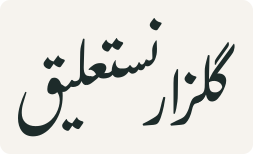
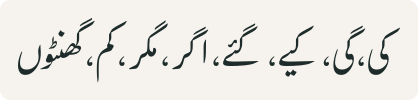
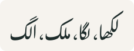
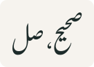
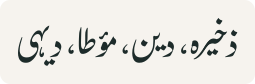
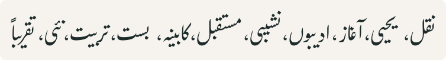

<p align="center"></p>

# Gulzar Nastaliq

Gulzar Nastaliq is a modified version of Gulzar. It was forked from [Gulzar](https://github.com/googlefonts/gulzar), the original font, by Borna Izadpanah, Simon Cozens and the Gulzar team, and reworked to look more like traditional Urdu Nastaliq as it is written and printed in books. Every outline is Gulzar's own, reshaped by `scripts/nastaliq-reshape.py`, and the shaping engine is Gulzar's. It is released, like Gulzar, under the SIL Open Font License 1.1.

**Download:** the latest font is attached to the [Releases](../../releases/latest) page as `GulzarNastaliq-Regular.ttf`.

Urdu examples below are images set in Gulzar Nastaliq itself.

## What has changed

### A more traditional Nastaliq style

* Proportions closer to traditional Urdu Nastaliq: lower, rounder bowls, taller ascenders, a heavier pen with more thick-and-thin contrast, and tighter word spacing.
* A lower slope in joined words (نستعلیق) so lines need less height, keeping Gulzar's look. Medial letters sit a little lower and shapes are kept intact, including ھ (پھر، بھا).
* The feet of و د ر follow the traditional kursi rule: و, د and ر end at one level, in standalone and in attached final forms, and bowl letters (ک گ ب ت ف ط ع ج ق ن ے) at the bowl line.
* Shorter kaf and gaf where they used to stand too tall, with the upright stem shortened and the sarkash keeping its length. A medial kaf or gaf comes down only where no dots or vowel marks sit under its sarkash, and کیا، گیا keep a taller kaf.



* A slightly lower laam before kaf and gaf, so it no longer towers over the kaf.



* Smoother joins between letters: into laam, dal and ye, and the sad and zad joins.



* Rounded pen cuts and stroke ends instead of hard straight edges, including the flat side of the fe and qaf heads. A slightly smaller ھ.
* Better spacing after letters that do not join (د ذ ر ز و), including around کر and پر, so words read as one word.



### Dots and marks

* Many dots placed closer to their letters and clear of each other. Each change is checked against the shaping and collision tests, so dots that move closer do not run into other letters, dots or words.



### Honorifics

Honorific ligatures drawn from the font's own letters with full harakat and sized to match each other. Each row shows the plain text, its code point, and how it looks in Gulzar Nastaliq:

| Honorific (plain text) | Code point | In Gulzar Nastaliq |
|---|---|---|
| صلی اللہ علیہ وسلم | U+FDFA |  |
| صلی اللہ علیہ وآلہٖ وسلم | U+FD4C |  |
| رضی اللہ عنہ | U+FD41 |  |
| رضی اللہ عنہا | U+FD42 |  |
| رضی اللہ عنہم | U+FD43 |  |
| رضی اللہ عنہما | U+FD44 |  |
| رضی اللہ عنہن | U+FD45 |  |
| رضی اللہ عنہ (small sign) | U+0613 |  |
| رحمۃ اللہ علیہ | U+0612 |  |
| عزوجل | U+FDFF |  |
| قدس سرہ | U+FD4B |  |
| علیہ السلام | U+FD47 |  |
| علیہم السلام | U+FD48 |  |
| علیہما السلام | U+FD49 |  |
| علیہا السلام | U+FD4D |  |
| علیہ السلام (small sign) | U+0611 |  |
| علیہ الصلوۃ والسلام | U+FD4A |  |

Typed phrases turn into these glyphs automatically: write the phrase in plain text (with or without harakat, with or without spaces between the words, with Urdu or Arabic ye and he) and it is shown as the single honorific. A phrase that is only part of a longer word (سلمان، اللہیار) is left alone.


### Optimised and tested

* Shaping and collision tests run over the regression suite, a large Urdu word corpus and full book pages.
* `qa/book-page.py` sets a page of text like a printed book page (justified lines, running head, verse centred), and can report lines whose ink touches, to judge the font for book printing.
* `qa/shaping-report.py` prints collision counts so two builds can be compared.
* `scripts/readme-images.py` renders the images used in this file from the font.

The rest of this file is Gulzar's original documentation.

Gulzar is a Nastaliq font for Urdu text with a typographic, rather than calligraphic feel.

## Note to other font designers

We hope that Gulzar will serve as a reference and model for other Nastaliq font designs, in particular in terms of its engineering and shaping rules. If you are looking to design a Nastaliq font, you will find some documentation on the Gulzar system and how it works in [engineering.md](engineering.md).

## Set up instructions

Only needs to be done once:

```
sudo pip3 install -r requirements.txt
```

## Build instructions

Don't try exporting from Glyphs! It's not going to work!

* Run `make`
* Output can be found in `fonts/ttf/GulzarNastaliq-Regular.ttf`

## Makefile targets

* `make` produces a debug version of the font.
* `make release` produces a version of the font suitable for release.
* `make test-shaping` checks the shaping rules and produces a report in `qa/shaping_tests/report.html`.
* `make test` runs a full fontbakery check on the font.
* `make proof` produces `urdu-john.pdf`, a proof of the font.
* `make testproof` produces `test-failures.pdf`, PDF containing words with collisions.

## Fixing dot collisions

If you find a colliding sequence between two "words" (i.e. final glyph -> initial glyph + dots), you need to:

* Add the sequence to `qa/shaping_tests/collisions.json` so it can be tested.
* Create a debug build of the font; the `Makefile` by default turns on `FONTTOOLS_LOOKUP_DEBUGGING=1` which creates a `Debg` table in the final font. This is stripped when building the release version.
* Strip the sequence down to the smallest possible string which collides. Paste that string into [Crowbar](http://www.corvelsoftware.co.uk/crowbar/) with the debug build of the font.
* Look down the list of trigged lookups to determine the sequence height. The list will include lookup names like `At_600_800_AtHeight600sub` and `At_600_800_AtHeight600pos` - this tells you the height-specific lookup routines you need to modify to mitigate the collision.
* Find those lookups in `anchor-attachment.fez`.
* Decide how you want to mitigate the collision. You can either:
    *  drop the dot one position (call `DropOne` in the `sub` lookup)
    *  drop it two positions (`DropTwo` in `sub`)
* and/or:
    *  open a short space (`OpenSmallSpaceBeforeKern` in `pos`) 
    *  open a large space (`OpenSpaceBeforeKern` in `pos)`
    *  bring the final glyph closer to the initial glyph (`Tighten` in `pos`)
    *  move the dots down a little further (`DropATinyBitMore`) or a lot further (`DropALotMore`, both in `pos`)
    *  raise the dots a little (`Raise` in `pos`)
    *  or do something more fancy, and create a new routine to reposition the dots elsewhere.
* Add a Chain rule call the appropriate routine(s). This is a bit of an art form. It should be as general as possible to avoid proliferating unnecessary rules, but as specific as possible to avoid interacting with other sequences in bad ways. Some hints:
    * Try to use the shape-based classes (e.g. `@dal_like`) to address the final glyph and all other glyphs like it.
    * Check out other similar sequences to see how best to address the initial glyph.
    * Consider using `DoNothing` and `DoNothingPos` (ignore rules) to create exceptions for existing situations.
* Rebuild the font and run `make test-shaping` to make sure there are no unwanted interactions with other sequences.

## Scripts

This repository also contains FEZ plugins for Nastaliq as well as scripts to build the font file:

* `dump-glyphs-rules.py` turns the Nastaliq Connection information within the `.glyphs` file into a CSV file so that it can be processed by the `nastaliqTools.NastaliqConnections` plugin.
* `find-notdefs.py` finds characters not currently mapped in the font.
* `lint-arabic.py` finds missing entry/exit anchors (and will, in the future, also detect other anchor issues.)
